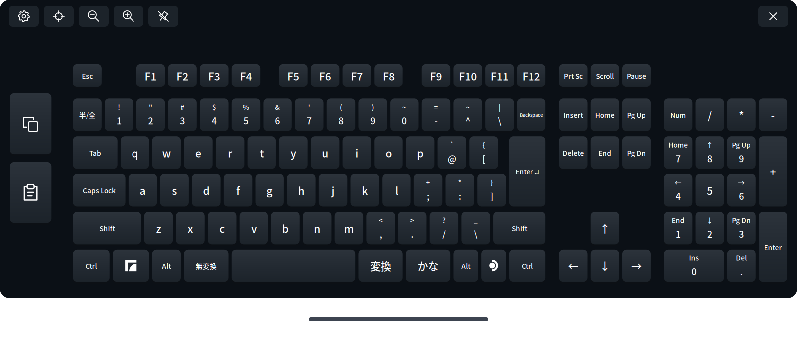

# Full Keyboard for Steam Frame

[English](README.md) | **日本語**

Steam Frame本体で使う、フルサイズの仮想キーボードです。矢印キー、テンキー、Ctrl・Alt・Shift、コピー／貼り付けボタンを備え、ブラウザーでの入力やデスクトップ上の編集に利用できます。

このフォークには、**JIS配列・ローマ字からのかな漢字変換・半角／全角切り替え**のための追加設定と、キーボードを表示／非表示にするヘルパーが含まれています。



*追加のJISプロファイルを使い、アプリのネイティブ描画で出力した画像です。*

## JIS版を使うには

1. 下記の手順で通常版のFull Keyboardをインストールします。
2. [JIS版の導入手順](extras/jis-desktop/README.ja.md)に従い、追加プロファイルとヘルパーを設定します。
3. アプリ一覧の **Full Keyboard（表示／非表示）** から開きます。同じ項目をもう一度選ぶと閉じ、次に選ぶと再表示します。
4. デスクトップの入力欄を選び、`nihon` → Space → Enterで **日本** と入力できることを確認します。
5. **半/全** キーで日本語と英数入力を切り替えます。

JIS配列の **@ はPの右隣**です。Shift＋2では引用符の `"` が入力されます。

この追加設定は、通常版に付属する内蔵ローマ字変換や、実験的な標準キーボード置換とは別の方式です。追加設定ではデスクトップ側のIBus/Anthyで変換し、候補をアプリ側に表示します。新しいARM64実行ファイルを配布するものではありません。

## 主な機能

- F1〜F12、矢印キー、ナビゲーションキー、テンキーを備えた配列。
- Ctrl・Alt・Shiftを使うショートカットと、コピー／貼り付けボタン。
- コントローラーのレーザーとトリガーによる入力、押下・解放時の振動。
- キーボードの移動・回転・拡大縮小、ダッシュボードへの追従。
- 配置と設定の保存、再起動時の復元。
- VR内でのレイアウト・言語・テーマの選択。
- JSONファイルを使う独自プロファイルの追加。
- 日本語のほか、英語・ドイツ語・フランス語・スペイン語・イタリア語・ブラジルポルトガル語・ロシア語・ウクライナ語・中国語・韓国語のプロファイル。

## 利用できる範囲

Steam Frame本体のダッシュボードと、デスクトップなどのローカルアプリ向けです。入力先の欄を選んでから、キーボードを操作してください。

**PCから配信しているVRChatなどへの入力は対象外です。** ダッシュボードを閉じるとキーボードは非表示になり、保持中のキーを解放します。

JIS追加設定は、SteamOS 0.4.5とChromeのX11/XIM構成で確認されています。ほかのアプリ、フローティングウィンドウ、今後のSteamOSでは、入力先やIMEの動作確認が必要です。詳しくは[動作とトラブル対処（英語）](docs/runtime.md)を参照してください。

## 通常版をインストールする

以下は **0.8.2** の例です。リリース版の導入にコンパイルや`sudo`は必要ありません。

1. Steam Frameのブラウザーで[元プロジェクトのリリースページ](https://github.com/TaiKeid/steam-frame-full-keyboard/releases)を開きます。`framekeyboard-0.8.2-aarch64.tar.gz`と`SHA256SUMS`をDownloadsへ保存します。
2. デスクトップの端末で確認・展開・インストールします。

   ```sh
   cd ~/Downloads
   sha256sum -c SHA256SUMS
   tar -xzf framekeyboard-0.8.2-aarch64.tar.gz
   cd framekeyboard-0.8.2-aarch64
   bash install.sh
   ```

   チェックサムが`OK`になったことを確認してから進めてください。別バージョンでは、ファイル名と展開先をそのバージョンへ読み替えます。GitHubが自動生成するソースコードのアーカイブは、この通常版インストール用パッケージではありません。
3. 通常版だけを使う場合は、アプリ一覧の **Full Keyboard**、または次のコマンドで起動できます。

   ```sh
   ~/.local/bin/framekeyboard
   ```

JIS追加設定を使う場合は、この後に[日本語の導入手順](extras/jis-desktop/README.ja.md)を進めてください。プロファイルを選ぶだけでなく、対応するIMEと起動時の設定も必要です。

通常版はホームディレクトリ内へインストールされます。自動起動は既定で無効です。Steamライブラリにも登録する場合は、Steamの「非Steamゲームを追加」からFull Keyboardを選びます。

## 操作方法

| 操作 | 方法 |
| --- | --- |
| 文字を入力 | キーにレーザーを合わせ、トリガーを押す |
| ショートカット | Ctrl・Alt・Shiftをタップしてから別のキーを押す。または片手で修飾キーを保持し、もう片方でキーを押す |
| タップした修飾キーを解除 | 同じ修飾キーをもう一度タップ |
| コピー／貼り付け | 左側の専用ボタンを使う。コピー前に対象の文字を選択する |
| 日本語の変換（JIS追加設定） | ローマ字で入力し、Spaceで変換、Enterで確定 |
| 日本語／英数の切り替え（JIS追加設定） | 半/全キーを押す |
| 表示／非表示（JIS追加設定） | アプリ一覧のFull Keyboard（表示／非表示）を選ぶ |
| 移動・回転 | ピン留めを解除し、キーボード下の線をトリガーで保持して動かす |
| 奥行きを変える | 移動中、同じ手のスティックを上下へ動かす |
| ヘッドセットのカーソルを使う | AUXでカーソルを表示し、狙ったキーをAUXでクリックする |
| つかんで移動 | SettingsのGeneralでUse Drag to Moveを有効にし、Apply and save。その後グリップで保持して動かす |
| 移動を防ぐ | ピンのアイコンを使う |
| サイズを変える | ツールバーの縮小／拡大ボタンを使う |
| テンキーを隠す | Settings → General → Hide numpadを選び、Apply and save |
| 配列・言語・テーマを変える | 歯車のSettingsから選び、Apply and save |
| 中央へ戻す | ツールバーの中央へ戻すボタンを使う |
| キーボードを閉じる | 右上の×。通常モードでは終了、標準置換モードでは非表示になる |

通常版のランチャーを起動済みの状態でもう一度実行すると、既存のキーボードを中央へ戻します。**JIS追加設定の表示／非表示ランチャーは、起動中なら閉じる操作になります。**

位置・回転・サイズは通常終了時に保存されます。強制終了では最後の移動が保存されないことがあります。

## 日本語入力の方式

| 方式 | 入力と変換 |
| --- | --- |
| 通常版のRomaji | キーボード内でローマ字をかなへ変換し、Anthyで漢字候補を作る |
| 通常版のKana | JIS位置のかなを直接入力し、キーボード内で変換する |
| 通常版のJIS / system IME | 既に設定済みのシステムIMEへ物理キーを送る |
| このフォークのJIS追加設定 | Frame向けの半/全キー対応と開閉ヘルパーを使い、デスクトップのIBus/Anthyでローマ字入力・かな漢字変換する |

通常版の内蔵変換では、Spaceで候補選択を始め、Enterで入力先へ確定文字を送ります。変換中でない状態のEnterは、通常のEnterとして送られます。JIS追加設定では入力先アプリのIMEが変換を担当します。

詳しい通常版の仕様は[日本語入力の説明（英語）](docs/japanese.md)、JIS追加設定は[日本語の導入手順](extras/jis-desktop/README.ja.md)を参照してください。

## 標準キーボード置換と自動起動

通常版には、実験的な **Replace native keyboard** があります。対応する要求について、起動中のFull Keyboardが標準キーボードを一時的に引き継ぎます。Steam Developer Modeが必要で、利用できない場合は標準側へ戻します。

**JIS追加設定ではReplace native keyboardとStart with SteamOSを無効にしてください。** 外部JISモードはこの置換機能の対象外です。JIS追加設定は、アプリ一覧の表示／非表示ランチャーから手動で使います。

通常版の置換機能については[実験的な標準キーボード置換（英語）](docs/native-replacement.md)を参照してください。

## 更新と元に戻す方法

通常版のアプリはSettingsの **Check for updates** から更新できます。手動更新ではFull Keyboardを終了し、対応するリリースパッケージを再インストールします。標準置換を有効にしている場合は、Settings → Quit Full Keyboardで終了します。

通常の更新でユーザープロファイルは保持されますが、アプリ一覧のカスタム起動項目が上書きされた場合は、JIS導入手順の起動項目を再設定してください。以前の構成へ戻す手順も[JIS導入手順](extras/jis-desktop/README.ja.md#以前の構成へ戻す)に記載しています。

## カスタマイズとデータ

独自のJSONプロファイルは次のフォルダーへ追加できます。

```text
~/.config/framekeyboard/layouts/
~/.config/framekeyboard/languages/
~/.config/framekeyboard/themes/
```

新しい`id`を使うと選択肢を追加でき、既存と同じ`id`を使うとユーザー設定として上書きできます。詳しい仕様は[設定リファレンス（英語）](docs/configuration.md)を参照してください。

コピー／貼り付けはショートカットを送ります。クリップボードや認証情報を読み取る機能ではありません。Full Keyboard本体は入力文字をログに記録せず、配列・表示設定・配置などを端末内に保存します。

## 開発資料とライセンス

- [ビルド方法（英語）](docs/building.md)
- [設計とコード構成（英語）](docs/architecture.md)
- [手動での動作確認（英語）](docs/acceptance.md)
- [ロードマップ（英語）](docs/plan.md)
- [変更履歴（英語）](CHANGELOG.md)
- [報告・貢献方法（英語）](CONTRIBUTING.md)

不具合を報告するときは、アプリとSteamOSのバージョン、対象アプリ、デスクトップかフローティングウィンドウか、再現手順を添えてください。画像やログから個人情報を取り除いてください。

プロジェクトのコードは[MIT License](LICENSE)です。同梱する第三者のコードには、それぞれの[ライセンス](third_party/README.md)が適用されます。元プロジェクトには、AI生成のコードを使っている旨の説明があります。
